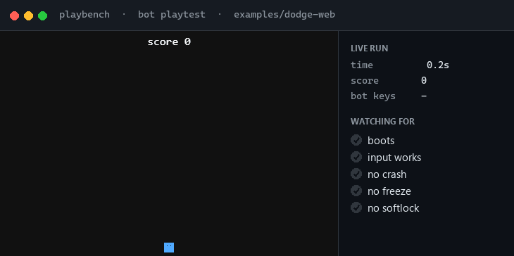
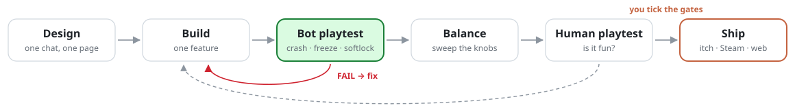
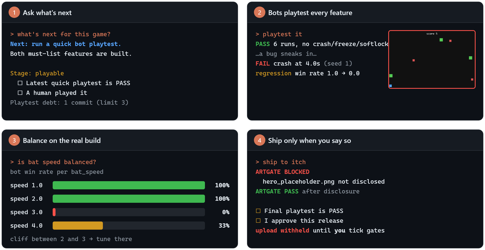

# playbench

**Bots playtest your game after every feature. You stay in charge of the fun.**

A plugin for AI coding agents that covers every game-dev loop: design, build, playtest, balance, iterate, log, ship. Works with **Claude Code, Codex, Cursor, GitHub Copilot, Gemini CLI**, and any agent that reads `SKILL.md` skills.

A playbench bot playing the real build of the sample game. No human hands.

---

## Why

Most indie games die the same way: a bug from hour 2 gets found at hour 40, nobody playtests until it "feels ready", and the release goes out with placeholder art still in it.

playbench catches each of those early:

- 🤖 **After every feature**, bots play your real build and catch crashes, freezes, softlocks and dead controls.
- 📊 **Balance on the real game.** It sweeps a value such as enemy speed and shows you where the difficulty falls off a cliff.
- 🚦 **Ship with gates.** Undisclosed AI or placeholder art is blocked, and nothing uploads until *you* tick the release gates.

## How it works

<picture>
  <source media="(prefers-color-scheme: dark)" srcset="docs/assets/flow-dark.svg">
  
</picture>

Each loop is one skill (`/playbench:design`, `build`, `playtest`, `balance`, `iterate`, `log`, `ship`), and `/playbench:studio` tells you which loop you're in and what to do next. Also new in 0.2:

| | |
|---|---|
| 🔁 **Auto-playtest hook** | When game changes pile up, your agent is reminded to run a one-minute bot playtest (Claude Code, Codex) |
| 🔒 **Gate guard** | Your agent can't tick a `gates.md` box, even if asked (enforced in Claude Code and Codex) |
| 🧭 **Agent playtests** | Your agent plays menus and choices step by step from screenshots, and the path replays as a test |
| 🎭 **Personas** | Newbie, min-maxer, explorer and quitter comment on milestone runs (opinion, not a fun verdict) |
| 🎨 **`art`** | Art bible, clearly labelled `_placeholder` sprites, atlases; ship blocks undisclosed ones |
| 💬 **`feedback`** | Player comments from itch, Discord or a survey into one ranked list |
| 📝 **`postmortem`** | What went right and wrong, with numbers from git and your playtests |

## See it work

Built from real runs on the bundled <code>examples/dodge-web</code> game, trimmed to fit.

## Install

| Agent | Install |
|---|---|
| **Claude Code** | `/plugin marketplace add MihirSahu14/playbench` then `/plugin install playbench@playbench` |
| **Codex** (CLI + app) | `codex plugin marketplace add MihirSahu14/playbench` then `codex plugin add playbench@playbench` |
| **GitHub Copilot CLI** | `copilot plugin install MihirSahu14/playbench` |
| **Gemini CLI** | `gemini extensions install https://github.com/MihirSahu14/playbench` |
| **Cursor, OpenCode, Windsurf, Amp, Goose, Cline, …** | `git clone https://github.com/MihirSahu14/playbench` then `python playbench/scripts/install.py` |

`install.py` copies the 11 skills to `~/.agents/skills/` as `playbench-<name>`, the shared folder most agents read. Use `--agent cursor|cline|windsurf|…` for a tool's own folder, `--project <dir>` for one repo only, and `python scripts/install.py list` to see every path.

Requires Python 3.11 or newer. Browser playtests also need Playwright, and the `art` skill needs Pillow. playbench prints the exact install line the first time you need one.

Tested live in **Claude Code** and **Codex**, where the studio skill and a full bot playtest both pass. The other agents use each tool's documented plugin or skills format but haven't been tested end to end yet. The gate-guard and auto-playtest hooks run in Claude Code and Codex. On other agents the same rules live in the skill text.

## Try it in 60 seconds

Open your agent in your game folder and just talk:

1. **"Set up playbench for a jam."** A few quick questions: what kind of project, how much you code, engine, deadline.
2. **"Let's design it."** You get a hook, a core loop and a must/cut list on one page.
3. **"Build the next feature."** Your agent writes one small slice, then bots playtest it.
4. **"A friend played it, here are my notes."** These are logged against your design goals.
5. **"What should we change?"** You get one ranked list from the bots, your notes and player feedback.
6. **"Ship to itch."** when you're ready.

Not sure where you are? Ask **"what's next?"**.

## Made for

| You are… | playbench gives you… |
|---|---|
| 🏃 **Game-jammer** | A deadline countdown, a one-minute playtest after each feature, and an itch zip that's been boot-checked |
| 🌙 **Solo hobbyist** | Scope that fits your hours, and a nudge when you've gone too long without testing |
| 👥 **Small team** | Gate owners, playtest regressions between runs, Steam build config, and who-approved-what from git |
| 🎨 **Designer who codes a little** | Your agent writes the test hooks and bots; you tune numbers in data files |
| 🎓 **Student** | A course AI policy (open, disclose or banned) and an honest record of AI use |

**Engines:** **verified on plain JS and Unity 6 WebGL** ([examples](examples)). Other HTML5 exports (Phaser, Godot web, GameMaker, Construct, GDevelop) use the same probe contract but are untested. Godot native is experimental.

## What bots can't do

Bots find what's broken. They can't tell you whether the game is **fun**. The early gates (prototype and vertical slice) require a human playtest, and only humans tick gates.

## Learn more

- [Reference](docs/reference.md): commands, the probe contract (how bots read your game), the AI-art policy, state files
- [Changelog](CHANGELOG.md) · [Design spec and roadmap](docs/superpowers/specs/2026-10-13-playbench-design.md)
- **Coming next:** Godot native verified on a real Godot binary (today it is tested against a stub, so it stays experimental), Aseprite and uploads checked against the real tools, a hosted runner

## Contributing

Issues and PRs are welcome. Run `python scripts/selftest.py` before opening a PR; it should print `ok selftest`. To regenerate the README visuals, run `python docs/assets/generate.py`.

## License

[MIT](LICENSE) © 2026 Mihir Sahu
